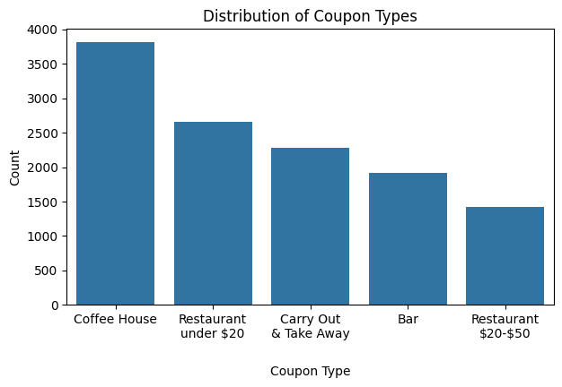
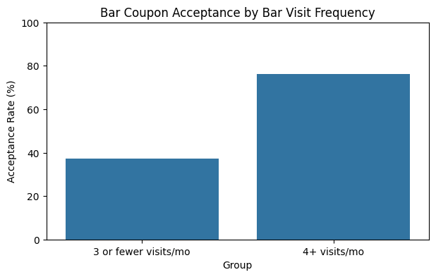
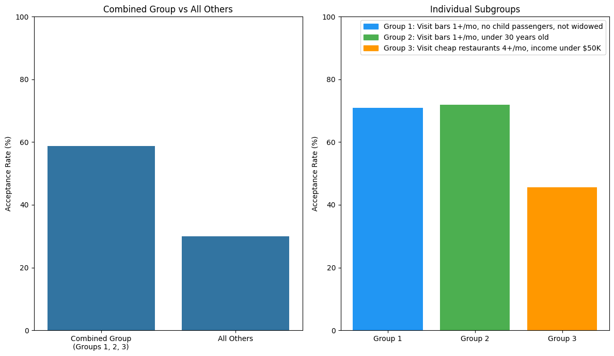
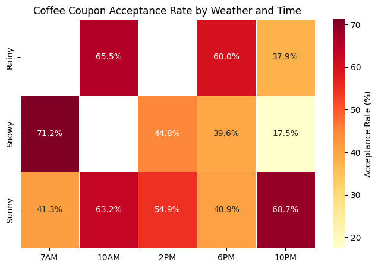
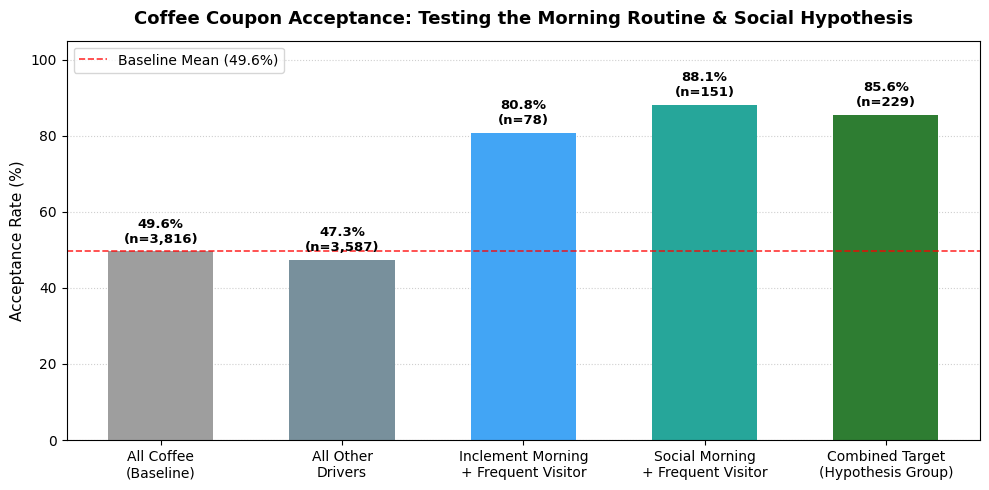
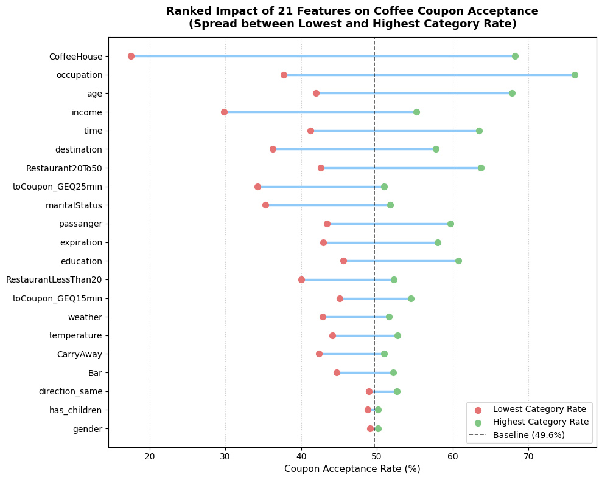

# Will the Customer Accept the Driving Coupon?
### Practical Application 1: Machine Learning & Probability Distributions

This project analyzes survey data from the UCI Machine Learning Repository to identify the factors that drive a customer's decision to accept or reject mobile driving coupons delivered to their phone. The project explores customer demographics, driving contexts, and dining habits, featuring focused investigations into **Bar Coupons** and **Coffee House Coupons**.

The full analysis, statistical code, and data visualizations can be found in the Jupyter Notebook:
[prompt.ipynb](prompt.ipynb)

---

## Dataset Overview

The dataset describes driving scenarios surveyed via Amazon Mechanical Turk. After dropping the uninformative `car` attribute (which was missing over 99% of values) and removing missing observations, the cleaned dataset contains **12,079 observations** across 25 features.

- **Overall Acceptance Rate:** **56.9%** (6,877 accepted out of 12,079 offers).
- **Distribution of Coupon Types:** Coffee House coupons represent the largest single coupon group offered to drivers, followed by cheap restaurants and carryout.

---

## Investigation 1: Bar Coupons

The first phase of the study explored driver receptivity toward bar coupons (**1,913 total offers**, baseline acceptance rate of **41.2%**).

### 1. The Impact of Prior Visit Frequency
Prior habit is the single most powerful indicator of whether a driver will accept a bar coupon:
- Drivers visiting bars **4 or more times a month** accepted coupons at **76.2%** (147 out of 193).
- Drivers visiting bars **3 or fewer times a month** accepted at only **37.3%** (641 out of 1,720).

### 2. Demographic and Contextual Filters
- **Age and Frequency:** Drivers who visit bars at least once a month and are over 25 years old had a **69.0%** acceptance rate, compared to **33.8%** for all others.
- **Passengers and Profession:** Drivers who visit bars at least once a month, travel without children, and work in professions outside farming, fishing, or forestry accepted at **70.9%** (compared to **29.8%** for all others).
- **Multi-Condition Exploration:** Evaluating drivers who met any of the three criteria (frequent bar goers without kids/not widowed; frequent bar goers under 30; or frequent cheap restaurant diners earning <$50k) yielded an acceptance rate of **58.7%** (n = 746) versus **30.0%** for all remaining drivers.

### 3. Hypothesis & "Sweet Spot" Cohort
Combining the strongest positive signals identified a core customer segment:
- **Hypothesis Group:** Drivers aged 26–30 who visit bars 4+ times a month and do not have children in the car.
- **Results:** This group achieved an **84.1% acceptance rate** (n = 69).
- **Caveat:** This specific cohort represents ~4% of total bar coupon responses and ~7% of all accepted coupons. While the sample size is small (n = 69), the conversion lift (+42.9% above baseline) provides a strong targeting signal.

---

## Investigation 2: Coffee House Coupons

The second phase involved an independent investigation into Coffee House coupons (**3,816 total offers**, baseline acceptance rate of **49.6%**).

### 1. Weather and Time Dynamics
Acceptance rates for coffee coupons vary considerably across driving hours and weather conditions:
- **Peak Hours:** Morning (10 AM) and mid-afternoon (2 PM) show the highest overall baseline interest (~64% and ~55%).
- **Weather Catalysts:** Rainy mornings at 10 AM (**65.5%**) and snowy mornings at 7 AM (**71.3%**) demonstrated sharp spikes in coupon redemption compared to sunny early morning commutes (**41.3%**).

### 2. Testing the Morning Routine & Social Hypothesis
Based on initial observations, I formulated and tested the following hypothesis:

> **Hypothesis:** Drivers who have friends as passengers, frequently visit coffee houses, and are offered coupons during morning hours under inclement weather are the most likely to accept coffee coupons.

- **Social Morning Drive (Friends + 10 AM + Frequent Visitor):** Yielded an **88.1% acceptance rate** (n = 151), nearly 39 percentage points above the baseline.
- **Inclement Morning Commute (Rain/Snow + 7 AM/10 AM + Frequent Visitor):** Yielded an **80.8% acceptance rate** (n = 78).
- **Survey Structure Finding:** In this dataset, scenarios with friends in the car were exclusively recorded on sunny days (100% sunny). As a result, social leisure trips and inclement morning commutes represent two distinct, high-performing morning routines rather than an intersecting group.
- **Combined Target Group:** Drivers meeting either the Social Morning or Inclement Morning conditions accepted at **85.6%** (n = 229), outperforming all other coffee drivers (**47.3%**) by 38.3 percentage points.

### 3. Comprehensive 21-Feature Impact Analysis
To determine how much each individual column influenced the decision to accept or reject a coffee coupon, I evaluated all 21 relevant predictor columns across their constituent categories:

- **Impact Spread:** Past coffee house visit frequency created the widest performance gap (**50.7% spread** between 4+ visits and never), followed by occupation (**38.4%**) and time of day (**22.3%**). Demographics such as gender and having children had virtually zero impact (~1% spread).

---

## Actionable Recommendations

1. **Prioritize Frequency Over Demographics:** Allocate promotional budget toward customers with established habits (visiting >= 1 time a month). Habitual drivers convert at 75%–88%, making them far more responsive than non-patrons.
2. **Context-Aware Morning Coffee Triggers:**
   - Automate delivery of 2-hour coffee promotions between **7 AM and 10 AM**.
   - Deploy dynamic weather triggers to send coffee offers to morning drivers during local rain or snow events.
   - Deploy group-oriented coffee promotions around 10 AM when vehicle telemetry indicates multiple passengers or friends in the car.
3. **Negative Filtering for Bar Coupons:** Suppress mobile bar promotions when child passengers are detected in the vehicle or during morning/commute hours.

---

## Next Steps

1. **A/B Pilot Testing:** Conduct a real-world pilot targeting the identified sweet spots (young adult frequent bar goers without children; morning coffee commuters in rain/snow) to measure conversion lift against a baseline control group.
2. **Address Survey Sampling Gaps:** Collect additional survey or telematics data on passenger trips during inclement weather to see if the presence of friends reinforces coffee acceptance in the rain or snow as it does on sunny days.
3. **Predictive Scoring Model:** Train a classification model (e.g., Logistic Regression or a Tree-based ensemble) using the 21 predictor features to generate real-time acceptance probability scores for each driver before dispatching a coupon.
